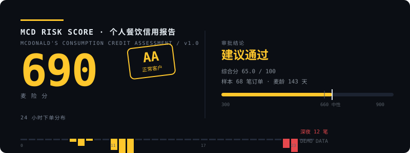

# 麦险分 · MCD Risk Score



> 用给信贷客群打分的模型，给你的麦当劳订单打个分。

基于麦当劳官方 MCP 的**只读**数据，构造一张信贷风格的评分卡，输出 **300–900 分的「麦险分」**、一个评级印章（AAA ~ C）、一条审批结论（建议通过 / 限制额度 / 人工复核 / 建议拒件），以及一份可以晒出去的单文件 HTML 信用报告。

- 📄 演示报告：[`examples/demo-report.html`](examples/demo-report.html)（直接浏览器打开，**无需 Token**）
- 🏅 1024 程序员节「麦当劳程序员创意开发大赛」参赛作品

---

## 它不是什么

榜上已经有一堆很棒的项目在做**年度总结**（`mcd-wrapped` 等）和**人格测试**（`mcd-personality`、`Mcdonalds-mbti` 等）。这个项目刻意不碰这两条线。

| | 年度总结 / 人格测试 | **麦险分** |
|---|---|---|
| 内核 | 回顾与娱乐 | **评级与风控** |
| 输出 | 「你是麦满分信徒」 | 「麦险分 702 · 评级 A · 建议通过」 |
| 方法论 | 创意归类 | **评分卡：特征提取 → 分箱赋分 → 加权映射** |
| 结论 | 描述性的 | **判人性的（通过 / 关注 / 拒件）** |

差别在方法论：评分卡的每个分值都能回溯到真实字段，分箱阈值写死在代码里可审计，缺失字段走中性分而不是补零。这是授信模型的基本要求，不是装饰。

---

## 报告卡长什么样

```
┌────────────────────────────────────────────────────────────────┐
│  MCD RISK SCORE · 个人餐饮信用报告            REF NO. MRS-…     │
│  ▬▬▬▬  MCDONALD'S CONSUMPTION CREDIT ASSESSMENT   2026-10-24   │
├────────────────────────────────────────────────────────────────┤
│                                                                │
│    690   ╔══════╗        审批结论：建议通过                     │
│  麦险分  ║  AA  ║        综合分 65.0 / 100 · 样本 68 笔         │
│          ║正常客户║        ▓▓▓▓▓▓▓▓│░░░░░                       │
│          ╚══════╝        300    660 中性    900                │
│                                                                │
├────────────────────────────────────────────────────────────────┤
│▎关键发现  你有 640 积分正在过期，占可用积分的 27%，资产减值      │
├────────────────────────────────────────────────────────────────┤
│  24 小时下单分布                                               │
│     ▁▁▂▁▁▁▁▂▅███▂▁▁▁▁▁▁▁▁▁▁▁▁▁▁▁▁▁▁▂▁▁▁▁▁▁▁▁▁▁▂▁            │
│     0        6        12        18        23                   │
│     深夜时段（22:00–05:00）共 12 笔，全天下单高峰在 12:00       │
├────────────────────────────────────────────────────────────────┤
│  麦龄时间轴                                                    │
│  ●·●··●···●··●···●··●····●··●··●···●··●··●····●··●             │
│  首单 2026-06-03        麦龄 143 天              最近 2026-10-23│
├────────────────────────────────────────────────────────────────┤
│  五维评分卡                                                    │
│   履约稳定性    ▓▓▓▓▓▓│░░░░  55  ×20%   间隔变异 0.78，频次偏高  │
│   预算约束力    ▓▓▓▓▓▓▓│░░░  62  ×20%   单笔金额变异 0.62       │
│   自律度       ▓▓▓▓▓▓▓▓│░░  82  ×25%   深夜订单 12 笔 (18%)     │
│   集中度       ▓▓▓▓▓▓▓▓│▓▓  90  ×15%   综合集中度 0.28         │
│   资产健康度    ▓▓▓▓│░░░░░░  38  ×20%  [短板] 积分/券沉睡率 50%  │
├────────────────────────────────────────────────────────────────┤
│  关键指标                                                      │
│   ┌────────┐ ┌────────┐ ┌────────┐                            │
│   │ 订单总数│ │  麦龄  │ │累计消费│                            │
│   │  68 笔 │ │ 143 天 │ │ ¥1,978 │                            │
│   └────────┘ └────────┘ └────────┘                            │
│   单均金额 ¥29.1   深夜占比 18%   最长连击 3 天   …            │
├────────────────────────────────────────────────────────────────┤
│  风险事件流水                                                  │
│   [高] DORMANT-POINTS  640 积分即将过期        过期前兑换       │
│   [中] LATE-NIGHT      深夜下单 12 笔 (18%)     纳入月度预算     │
│   [中] COUPON-EXPIRY   3 张券 7 日内失效        优先核销临期券   │
│   [中] AMOUNT-SPIKE    单笔最高为单均 3.2 倍    可能来自团餐     │
└────────────────────────────────────────────────────────────────┘
```

实际报告是**黑金信贷终端风**的单文件 HTML：深色底 + 金色强调线 + 金属降级评级色
（AAA 金 → A 银 → BBB 铜 → C 铁锈红）、24 小时下单分布柱、麦龄时间轴
（深夜订单标红点）、短板高亮的五维评分卡、分层的指标区。

系统字体栈，断网不塌，单文件可直接分享。

---

## 五维评分卡

| 维度 | 权重 | 核心信号 | 曲线形状 | 业务解释 |
|---|---:|---|---|---|
| 履约稳定性 | 20% | 间隔变异系数 CV **× 平均间隔** | 双因子 | 规律且频次健康才高分；天天吃＝高频依赖，扣分 |
| 预算约束力 | 20% | 单笔金额变异系数 | 单调递减 | 金额稳定 = 有预算意识，不冲动加购 |
| 自律度 | 25% | 深夜订单占比 + 单均热量 | 惩罚式 | 生活方式风险，权重最高 |
| 集中度 | 15% | 门店 / 品类 HHI | **U 型** | 过度集中是单点依赖，过度分散是缺乏忠诚 |
| 资产健康度 | 20% | 积分 / 券的沉睡率 | 单调递减 | 沉睡资产＝资产减值，资产管理能力差 |

**集中度为什么是 U 型**：这是授信模型里真实的逻辑——客户集中度过高是单点依赖风险，过低则没有稳定关系。最优区间在 HHI 0.25–0.60。评分卡里最不"拍脑袋"的就是这条。

**履约稳定性为什么是双因子**：只看规律性会掉进一个坑——每天吃麦当劳的间隔变异系数接近 0，
会被判成"极稳定＝优质"，但高频依赖在授信逻辑里是共债风险。所以同时纳入平均间隔：
平均 <1.5 天一单属高频依赖直接扣分，7–14 天最健康。
（这条是实测时发现的：改之前，一个"天天深夜吃、八家门店漂移、积分全过期"的样本
拿了 694 分 A 级，改完落到 640 分 BBB。）

### 白户机制（Thin File）

订单数 < 5 或观察窗 < 14 天时，分数照出，但审批结论强制改为
**「样本不足 · 暂不评级（白户）」**，报告顶部出现警告条。

授信业务对薄档案客户的标准做法就是拒绝判断，本项目沿用同一纪律——
**宁可不给结论，也不给一个站不住的结论。**

### 评级带

| 分数 | 评级 | 分类 | 审批结论 |
|---:|:---:|---|---|
| ≥ 780 | AAA | 优质客户 | 建议通过 · 可提额 |
| ≥ 720 | AA | 优质客户 | 建议通过 |
| ≥ 660 | A | 正常客户 | 建议通过 |
| ≥ 600 | BBB | 观察类 | 建议通过 · 纳入关注 |
| ≥ 540 | BB | 观察类 | 建议通过 · 限制额度 |
| ≥ 480 | B | 关注类 | 人工复核 |
| ≥ 420 | CCC | 关注类 | 人工复核 · 限制额度 |
| < 420 | C | 高风险 | 建议拒件 |

风险规则码：`LATE-NIGHT`（深夜加餐）、`STREAK`（连续下单）、`DORMANT-POINTS`（积分沉睡）、
`COUPON-EXPIRY`（券临期）、`AMOUNT-SPIKE`（大额异动）、`STORE-DRIFT`（门店漂移）、
`CATEGORY-LOCK`（品类锁定）。每条都只在真实数据支撑时才写入。

---

## 快速开始

### 1. 先看效果（不用装任何东西）

直接打开 [`examples/demo-report.html`](examples/demo-report.html)，或本地跑一遍：

```bash
python scripts/run.py --mock
```

用固定随机种子（1024）的演示数据跑通全流程，报告写到系统临时目录。
**评审和路人因此不需要申请 Token 就能验证整个项目。**

### 2. 三分钟套到你自己的数据上

整个项目是模板化的：`scripts/` 里五个文件各管一件事，想把方法搬到别的消费场景，
只需要替换数据入口 `scripts/mcp_client.py` 的取数部分，评分卡和报告卡一行都不用改。

| 想改什么 | 改哪里 |
|---|---|
| 换数据源 | `scripts/mcp_client.py`（`READ_ONLY_TOOLS` 白名单 + `FIELD_ALIASES` 字段映射） |
| 调评分权重 / 分箱 | `scripts/scoring.py`（`WEIGHTS`、`_bin_score` 阈值表） |
| 换报告样式 | `scripts/report.py`（`CSS` 与 `TPL` 两个字符串，纯前端，与逻辑解耦） |
| 换演示数据 | `scripts/mock_data.py`（改 `SEED` 或 `build_mock()` 的画像参数） |

换成麦当劳自己的真实账号，只需两步：

```bash
export MCD_MCP_TOKEN=你的Token      # Windows: set MCD_MCP_TOKEN=你的Token
python scripts/run.py --live
```

申请 Token：[open.mcd.cn](https://open.mcd.cn/mcp) → 手机号登录 → 控制台 → 激活 → 复制。

### 3. 接真实数据（详细说明）

申请 Token：[open.mcd.cn](https://open.mcd.cn/mcp) → 手机号登录 → 控制台 → 激活 → 复制

```bash
export MCD_MCP_TOKEN=你的Token      # Windows: set MCD_MCP_TOKEN=你的Token
python scripts/run.py --live
```

可选：`--out 路径.html` 指定落盘位置，`--json` 只输出结构化结果。

### 3. 在 WorkBuddy / 其他 MCP 客户端里用

把本仓库作为 Skill 安装，或直接复制 `mcp-config.example.json` 的配置（替换 Token）到客户端。

---

## 安全边界

麦当劳 MCP 的 33 个工具里有 7 个会产生真实后果。本项目**在协议层就全部拒绝**：

```
create-order  cancel-order  mall-create-order  party-order-create
draw-lottery  auto-bind-coupons  delivery-create-address
```

调用它们会直接抛 `WRITE_BLOCKED`，没有环境变量开关、没有绕过路径。原因很简单：
Agent 误下单一次就是真钱出去，而这部分风险不该由使用者承担。

其他边界：

- **Token 不落盘**：只从环境变量读取，报错信息里绝不回显 token。
- **报告不进仓库**：含个人消费数据，默认写系统临时目录，`.gitignore` 已排除。
- **不给消费建议**：不鼓励为了凑满减多消费，不给积分抽奖算期望值。
- **缺失走中性分**：拿不到的数据给 60/65 分而不是 0 分——补零会让分数虚低，等于造假。

---

## 项目结构

```
mcd-risk-score/
├── README.md
├── CONTEST_DECLARATION.md        参赛声明（官方原件，未改动）
├── MCP_INTEGRATION.md            MCP 集成说明
├── mcp-config.example.json       脱敏配置（仅环境变量占位符）
├── SKILL.md                      Skill 定义与工作流
├── scripts/
│   ├── mcp_client.py             只读 MCP 客户端（标准库，SSE/JSON 双兼容）
│   ├── scoring.py                特征提取 + 五维评分卡 + 风险规则
│   ├── report.py                 单文件 HTML 报告卡生成
│   ├── mock_data.py              固定种子演示数据
│   └── run.py                    主入口 --live / --mock
├── references/
│   └── pitfalls.md               实测踩坑记录
└── examples/
    └── demo-report.html          演示报告样例
```

零第三方依赖，Python 3.9+ 标准库即可运行。

---

## 方法说明

1. **取数**：4 个只读工具 → 订单、积分、券、营养表。
2. **特征**：间隔 CV、金额 CV、深夜占比、门店/品类 HHI、沉睡率、单均热量。
3. **分箱**：每维按阈值表落到 0–100 分，阈值硬编码可审计。
4. **加权**：五维按权重合成 0–100 综合分，线性映射到 300–900。
5. **出卡**：单文件 HTML，深色终端风，含分数条、五维条、KPI 网格、风险流水表。

---

## 免责声明

本项目为 1024 程序员节「麦当劳程序员创意开发大赛」参赛作品，由参赛者独立开发，
**非麦当劳官方产品**。报告结果仅供娱乐与自我观察，不构成医疗、营养、财务或任何专业建议。
餐品信息、价格及供应状态以麦当劳官方渠道的实时结果为准。

「麦当劳」「McDonald's」及金拱门标识均为麦当劳公司的注册商标。
